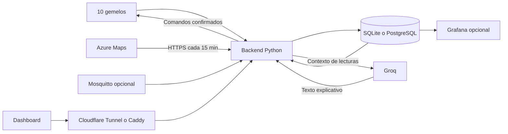

# Invernadero IoT — Verdant

Dashboard académico de un invernadero con diez gemelos digitales, clima exterior de Azure Maps y un asistente generativo con Groq.

## Qué se hizo

- Se crearon diez nodos lógicos D01–D10, distribuidos en dos zonas y con cuatro variables: temperatura, humedad del aire, humedad del suelo e iluminancia.
- Se implementó un generador reproducible de cinco días de demostración y una captura continua con la hora actual mientras el servicio esté encendido.
- Se integraron dos fuentes externas reales: condiciones meteorológicas y calidad del aire de Azure Maps, consultadas cada 15 minutos.
- Se construyó un panel de vidrio translúcido, con fotografía de un invernadero, gráficas interactivas, selector de fechas, medias, mínimos, máximos, alertas visuales y exportación.
- Se añadieron paneles movibles, ampliación del control y restauración del diseño. La distribución se guarda en el navegador, por origen.
- Se implementaron comandos para pausar/reanudar la adquisición, ajustar frecuencia, calibrar temperatura y simular riego con confirmación y registro.
- Se integraron recomendaciones locales y una extrapolación de humedad, además de explicaciones generadas con Groq.
- Se preparó una alternativa Docker con Mosquitto, PostgreSQL, Grafana y Caddy. El modo mínimo ejecuta Python y SQLite sin esos servicios.

D01–D10 son simulados: no hay sensores físicos ni bomba conectados. Azure proporciona datos externos reales. No se atribuye el historial simulado a mediciones físicas.

## Arquitectura



La simulación escribe directamente a la base; sus gráficas no demuestran intercambio MQTT. Ese receptor es una ruta adicional cuando se configura MQTT_HOST.

## Replicar en local

Requisitos: Git y Python 3.11 o posterior.

```sh
git clone https://github.com/Nicolas1609-1/Invernadero.git
cd Invernadero
cp .env.example .env
python -c "import secrets; print(secrets.token_hex(32))"
```

Guardar el secreto generado en ADMIN_TOKEN dentro de .env. Completar las claves opcionales de Azure y Groq sin publicarlas. En PowerShell se puede copiar con `Copy-Item .env.example .env`.

En Linux/macOS cargar la configuración e iniciar:

```sh
set -a
. ./.env
set +a
python3 app.py --seed
python3 app.py --live
```

En PowerShell, para el modo mínimo:

```powershell
$env:ADMIN_TOKEN = Read-Host 'Token de administración elegido'
python app.py --seed
python app.py --live
```

Abrir http://localhost:8080. Mantener el proceso activo para seguir acumulando lecturas; Ctrl+C lo detiene. iot.db conserva lecturas, estado y comandos. El modo SQLite y los adaptadores HTTP usan la biblioteca estándar; requirements.txt añade PostgreSQL y MQTT.

Sin definir ADMIN_TOKEN existe un valor de demostración: debe sustituirse antes de publicar. Las claves de Azure/Groq se leen del .env; las variables de arranque como ADMIN_TOKEN, PORT y BIND_HOST deben estar en el entorno del proceso.

## Configuración

| Variable | Uso |
|---|---|
| ADMIN_TOKEN | Autoriza control y recepción externa, no las preguntas a Groq. |
| BIND_HOST / PORT | Interfaz y puerto del backend. |
| AZURE_MAPS_KEY | Clave del servicio meteorológico, sólo en backend. |
| WEATHER_LAT / WEATHER_LON | Coordenadas elegidas para consultar el clima. |
| GROQ_API_KEY | Clave privada de Groq. |
| GROQ_MODEL | Modelo disponible en tu cuenta; se validó openai/gpt-oss-120b. |
| DB_PATH / DATABASE_URL | SQLite local o conexión PostgreSQL. |
| MQTT_HOST / MQTT_PASSWORD | Consumidor MQTT con usuario service. |
| APP_DOMAIN / GRAFANA_DOMAIN | Dominios de la alternativa Caddy. |

Nunca publicar .env, contraseñas, claves SSH, base de datos o telemetría privada. El CSV de ejemplo se recrea con --seed; está excluido del repositorio.

## Qué tiempo de telemetría tienes

- **Demostración:** --seed genera 57 600 valores del 26–30 de octubre de 2026. No acredita cinco días de servicio encendido.
- **Captura continua:** --live añade lecturas con hora actual. El contador superior muestra días/horas y valores realmente acumulados.
- **API externa:** Azure guarda respuestas desde la primera consulta válida; no se inventa historia anterior.

Pulsar **Ver periodo capturado** para consultar lo adquirido desde el despliegue. En vivo muestra la última hora. Las fechas son UTC y el final es exclusivo. Para ver un día, usarlo como inicio y el día siguiente como fin. Se devuelven hasta 10 000 puntos por serie.

Clima exterior distingue hora de consulta y hora de observación del proveedor: una consulta reciente no garantiza una medición nueva. Para acreditar 4–6 días hay que mantener el servicio funcionando y comprobar su historial.

## Cómo usar el control y la IA

El control admite publicación activa/pausada, intervalo de 5–3600 segundos y offset de temperatura de -5 a +5 °C. Los cambios afectan a datos futuros y conservan el histórico.

El asistente local señala suelo bajo 40 %, temperatura sobre 32 °C, datos antiguos y ausencia de riego registrado. No tener registro no demuestra que una planta física no se regara. La extrapolación requiere seis muestras que cubran 20 minutos y no es un modelo agronómico validado.

Simular riego pide confirmación y ADMIN_TOKEN. Acepta 50–1000 ml, registra el evento y aumenta temporalmente la humedad del gemelo. Bloquea repeticiones durante diez minutos y rechaza condiciones no válidas. No mueve agua real.

Groq recibe IDs lógicos, zonas, valores/fechas, riegos simulados y valores meteorológicos, sin coordenadas ni claves en el contenido. Admite preguntas de hasta 500 caracteres y una llamada global por minuto. La consulta no pide token al usuario; la key permanece en el servidor. El modelo no tiene herramientas para regar. Revisar sus respuestas y considerar cuota y consumo de la cuenta al publicar el panel.

Detalles: [Azure Maps](AZURE_MAPS.md), [Groq](GROQ.md), [sustentación](SUSTENTACION.md), [atribución del fondo actual](FONDO.md). ASSETS.md describe la primera iteración del fondo; la fotografía vigente se acredita en FONDO.md.

## Ejecutarlo permanentemente en un servidor Linux

Usar un supervisor como systemd para iniciar app.py --live desde la carpeta clonada, cargar .env y reiniciar en caso de fallo. Ejemplo genérico de unidad de usuario, ajustando USUARIO y rutas:

```ini
[Unit]
Description=Invernadero IoT
After=network.target

[Service]
WorkingDirectory=/home/USUARIO/Invernadero
EnvironmentFile=/home/USUARIO/Invernadero/.env
Environment=BIND_HOST=127.0.0.1
Environment=PORT=8088
ExecStart=/usr/bin/python3 app.py --live
Restart=on-failure
RestartSec=5
NoNewPrivileges=true

[Install]
WantedBy=default.target
```

Guardar como ~/.config/systemd/user/invernadero.service y ejecutar:

```sh
chmod 600 .env
systemctl --user daemon-reload
systemctl --user enable --now invernadero.service
systemctl --user status invernadero.service
```

Para seguir activo después de cerrar sesión, el administrador puede habilitar linger para el usuario. Después de actualizar código, reiniciar el servicio. Respaldar SQLite con el servicio detenido o mediante su mecanismo de backup, sin borrar el historial.

## Publicar con un túnel existente de Cloudflare

Cloudflare conecta un hostname público al backend; no se sube el código al túnel. Requiere un dominio en Cloudflare y un conector Healthy con acceso a la aplicación.

1. Ir a Networking → Tunnels → elegir el túnel existente.
2. Abrir Routes → Add route → Published application.
3. Introducir estos valores de ejemplo:

| Campo | Valor genérico |
|---|---|
| Subdomain | invernadero |
| Domain | tu-dominio.com |
| Path | Vacío |
| Service URL | http://localhost:8088, si conector y aplicación están en la misma máquina |

4. Si el backend escucha en otra interfaz o equipo, sustituir localhost por la dirección alcanzable desde cloudflared y conservar el puerto correcto.
5. Guardar con Add route y comprobar https://invernadero.tu-dominio.com desde otra red.

Un túnel admite varias rutas: puedes conservar otra aplicación y añadir invernadero como subdominio nuevo. Si reutilizas exactamente un hostname existente, editar su ruta cambiará la aplicación que muestra; no crear un duplicado.

El Service URL apunta al backend HTTP, no a GitHub ni al dominio público. Cloudflare configura el DNS asociado y sirve HTTPS al visitante. El túnel no necesita redirección de puertos entrantes del router. Si aparece 502, comprobar el proceso y la conectividad entre cloudflared y el origen.

Documentación oficial: https://developers.cloudflare.com/tunnel/get-started/

## Alternativa Docker: MQTT, PostgreSQL y Grafana

Completar .env, instalar Docker/Compose y crear las contraseñas del bróker:

```sh
docker run --rm -it -v "$PWD/mosquitto:/config" eclipse-mosquitto:2 mosquitto_passwd -c /config/passwords service
docker run --rm -it -v "$PWD/mosquitto:/config" eclipse-mosquitto:2 mosquitto_passwd /config/passwords operator
chmod 644 mosquitto/passwords
docker compose config --quiet
docker compose up -d --build
docker compose exec app python app.py --seed
docker compose ps
```

service debe usar MQTT_PASSWORD; operator tiene su propia contraseña. -c crea un archivo nuevo: no usarlo para añadir usuarios a uno existente. Proteger la carpeta del host.

El Compose base publica con Caddy: configurar APP_DOMAIN/GRAFANA_DOMAIN, DNS y acceso 80/443. Grafana usa admin y GRAFANA_PASSWORD e incluye datasource y dashboard PostgreSQL. Esta alternativa está preparada; la pila completa no se ha validado en el servidor del equipo. No migra automáticamente una base SQLite existente.

Para usar Compose con Cloudflare, crear un override que desactive Caddy y publique app en loopback con el puerto elegido. No ejecutar dos servicios en el mismo puerto. No publicar 1883 ni PostgreSQL a Internet; sensores externos necesitan VPN o TLS.

## Endpoints y protocolo

| Ruta | Función |
|---|---|
| GET /health | Estado del proceso |
| GET /api/devices y /api/data | Estado y lecturas por dispositivo/variable/fechas |
| GET /api/telemetry/status | Tiempo y conteos acumulados |
| GET /api/insights | Reglas y proyección local |
| GET /api/weather y /api/weather/history | Clima actual e historial externo |
| GET /api/ai/status | Estado público de Groq, sin key |
| POST /api/ai/groq | Pregunta, sin token y con límite temporal |
| POST /api/command | Comandos, requiere Bearer ADMIN_TOKEN |
| POST /api/telemetry | Recepción externa, requiere Bearer ADMIN_TOKEN |

MQTT 3.1.1 sobre TCP, QoS 1. Topics: greenhouse/D01/telemetry, greenhouse/D01/command y greenhouse/D01/ack; repetir para los diez nodos. No retener comandos. Lecturas deduplicadas por nodo/fecha/variable y comandos por ID. PUBACK no confirma actuación física; applied_twin confirma el gemelo. Los comandos MQTT incluyen id, issued_at como epoch actual y settings; expiran a los 60 segundos.

## Verificar y actualizar

```sh
python -m unittest -v test_project.py
```

Las diez pruebas cubren datos, deduplicación, control, riego, tendencia, datos antiguos, normalización de Azure y transporte simulado de Groq. También se comprobaron consultas reales de Azure/Groq y un riego simulado en el servidor.

Para actualizar una réplica, conservar .env y la base, ejecutar git pull --ff-only, repetir pruebas y reiniciar el servicio. El informe PDF preliminar debe actualizarse con arquitectura final, URL efectiva, commit y evidencia de 4–6 días antes de la entrega. No se validaron sensores físicos, alta disponibilidad ni pruebas de carga.
